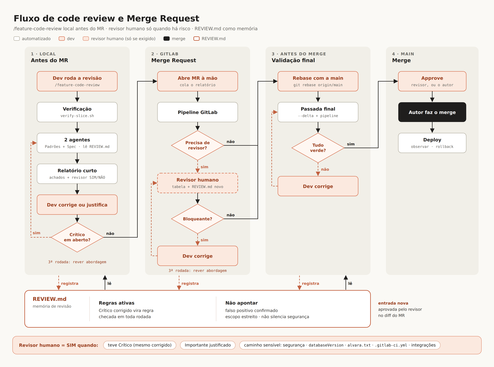

# /feature-code-review: revisão local antes do MR

Skill e agentes do Claude Code para o `empreendedor_server`. Baseados na skill [`code-review` de Matt Pocock](https://github.com/mattpocock/skills/blob/main/skills/engineering/code-review/SKILL.md), com a revisão em dois eixos independentes, cada um num agente de contexto limpo, e adaptados ao fluxo de MR do time:



## Estrutura

```text
claude-code-review-skill/
├── README.md
├── fluxo-code-review-final.png
├── REVIEW.md                                  → raiz do repo (memória de revisão)
└── .claude/
    ├── agents/
    │   ├── revisor-padroes.md                 eixo Padrões (rules, OWASP, REVIEW.md, smells)
    │   └── revisor-spec.md                    eixo Spec (CA, RN, contratos)
    └── skills/feature-code-review/
        ├── SKILL.md                           orquestrador do /feature-code-review
        ├── fluxo-code-review-final.png
        ├── references/
        │   ├── classificacao.md               Crítico · Importante · Nit · Pré-existente
        │   ├── relatorio.md                   templates do achados.md e do relatorio.md
        │   ├── code-smells.md                 12 smells do Fowler (base do Matt)
        │   └── caminhos-sensiveis.txt         caminhos que exigem revisor humano
        └── scripts/
            └── caminhos-sensiveis.sh          lista os arquivos sensíveis do diff
```

## Instalação no repositório

Na raiz do `empreendedor_server`, numa branch nova:

```bash
cp -r ../../claude-code-review-skill/.claude/agents/revisor-padroes.md \
      ../../claude-code-review-skill/.claude/agents/revisor-spec.md .claude/agents/
cp -r ../../claude-code-review-skill/.claude/skills/feature-code-review .claude/skills/
cp ../../claude-code-review-skill/REVIEW.md .
```

Com o nome `feature-code-review`, a skill não conflita com o `/code-review` nativo do Claude Code nem com a skill `code-review` que o repo já tem. Ajustes recomendados no resto do repo:

- **Skill `.claude/skills/code-review/` atual:** fica sobreposta ao `/feature-code-review`. A recomendação é remover, para o time não ter duas revisões diferentes.
- **`CLAUDE.md`, "Skills a invocar":** trocar `code-review` por `feature-code-review` em "Qualidade" e descrevê-la como a revisão local antes do MR.
- **`.claude/agents/code-reviewer.md`:** também fica sobreposto. Remova, ou mantenha só para revisões avulsas.
- **`.claude/skills/padronizacao-codigo/references/code-review.md`:** apontar para este fluxo.
- **Fluxo SDD (`implementar-sdd` + `revisor-codigo`):** fica como está por enquanto. Unificar com o `/feature-code-review` é uma decisão à parte.

## Uso

| Comando | Quando |
|---|---|
| `/feature-code-review` | antes de abrir o MR: revisão completa de `origin/main...HEAD` |
| `/feature-code-review --delta` | depois de corrigir os achados, ou depois do `git rebase origin/main` (validação final) |
| `/feature-code-review --config <alvara.txt> --tests <Classe>` | quando houver teste que sobe banco (repassado ao `verify-slice.sh`) |

Saídas temporárias em `target/feature-code-review/` (já ignorado pelo git):
- **`relatorio.md`:** curto, para colar na descrição do MR.
- **`achados.md`:** detalhe da sessão, não vai para o MR.

## Revisor humano = SIM quando

- houve Crítico em alguma rodada, mesmo corrigido;
- sobrou Importante (ou Crítico) justificado como intencional ou falso positivo;
- o diff toca um caminho de `references/caminhos-sensiveis.txt`.

Caso contrário, o autor aprova e faz o merge. Para isso, a opção "Prevent approval by author" do GitLab precisa estar desligada.

## Pontos a validar no primeiro uso

- **`caminhos-sensiveis.txt`:** a lista inicial saiu do código atual (`security/`, `databaseVersion/`, `integracoes/`, `tax/`, `ServerConfig.java`, CI e dependências). Ajuste com o time.
- **Commits:** a skill não faz commit (o `settings.json` bloqueia `git commit`). O dev commita o `REVIEW.md` e as correções.
